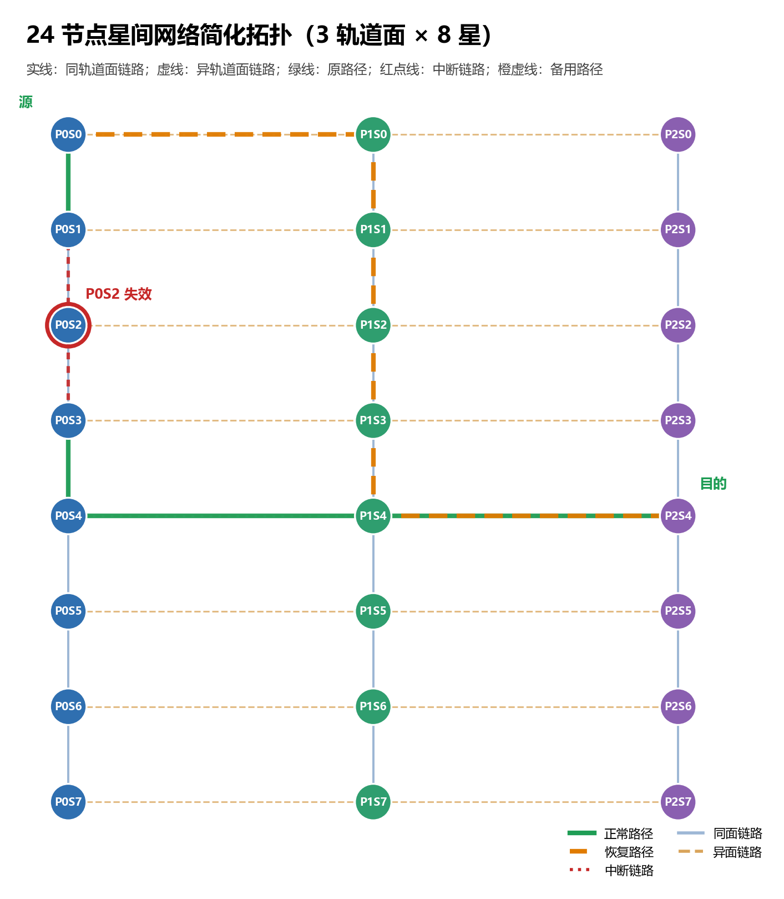
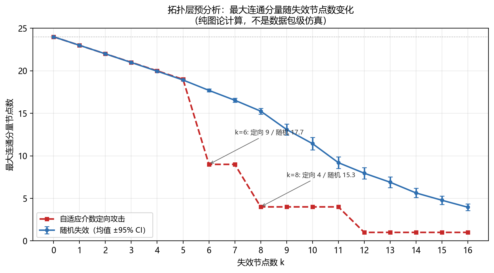
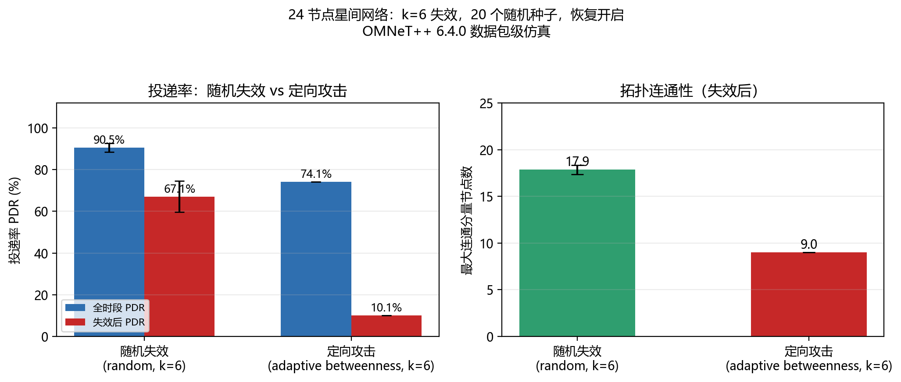
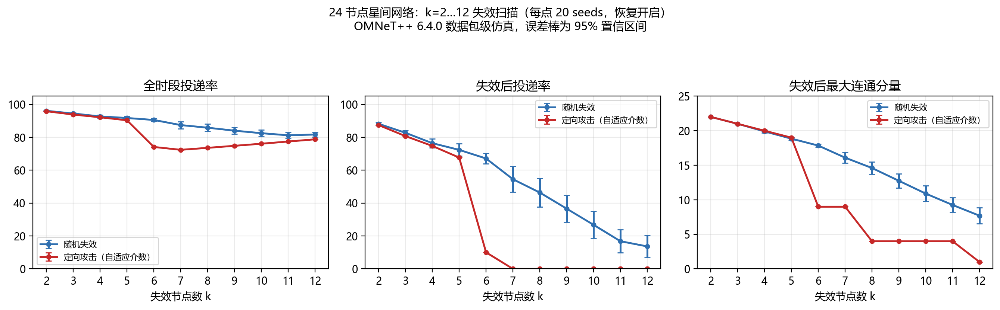

# 最终实现说明（2026-11-05）

下文保留早期方案作设计演进记录。最终报告及提交以本节、project/README.md和交付物/课程设计报告_成员A.docx为准。

- 实际模型：24节点、40双向链路、静态3×8拓扑；同面70 ms/跨面120 ms的ned.DelayChannel；没有10 Mbps容量限制、50包队列或2 ms处理时延。
- 每节点向(id+12)%24发1024 B，1包/s，1–60 s含末点，70 s结束；40 s失效，42 s集中式更新。
- 定向选点为离线自适应无权介数，40 s同时失效前k节点；路由为按传播时延加权Dijkstra。
- 实际指标：收发丢弃、全程/失效后同批PDR、平均成功包时延/跳数、LCC/分区、70 s窗有效吞吐、1440个计划包完成率。固定更新等待与业务首包恢复间隔分别报告；P95、攻击效率等不列作完成项。
- 507次新版实测与独立包级核验已完成。正式数据project/results/final-20261105/；旧44+440次结果保留并与新版共同指标全部核对一致。
- 单节点恢复真实路径及首包证据已补，随机k6更新开关20组配对已补；详见最新进度。


## 以下为历史记录，当前状态以上文为准

# 实施方案：基于 OMNeT++ 的导航卫星星间通信网络抗毁性与通信性能仿真

整理日期：2026-10-27（北京时间）

依据：《信息安全技术课程设计要求.docx》《物联网安全技术设计课程设计报告模板.docx》；选题参考《卫星导航技术学习手册_2027级研究生_1.00.docx》。

状态：教师已于 2026-10-27 确认题目与简化拓扑；OMNeT++ 6.4.0 已安装、编译并通过 4 节点/24 节点仿真验证。分组按用户意见先写 1 人，姓名学号待提供；课程原文要求 3—5 人，需确认。本文中标注“实测”的表格是真实运行结果，标注“预期”的部分不是实验结果。

---

## 0. 结论先行

1. **题目可行，且与方向 1 的“构建虚拟网络—通信质量—性能测试—安全评估”逐项对应。** 研究的是星间链路上的数据包转发、失效后的连通性与恢复，不是定位解算。
2. **技术上只需新增两件软件：OMNeT++ 6.4.0（Windows 版，自带 clang64 工具链、IDE、Qtenv）和 7-Zip 便携版（7zr）。** Python、VS Code、Office 本机已有；不需要 INET、NS2、WSL、Visual Studio、Qt、SUMO/Veins。环境已于 2026-10-27 完成安装、编译和运行验证。
3. **首版采用 OMNeT++ 原生模块，不装 INET。** 24 个节点、40 条链路的规模，自己实现数据包、链路、Dijkstra 路由和失效注入，比引入完整 TCP/IP 协议栈更可控，也更容易在 5 天内做出可验收的闭环。
4. **选题归类已由教师确认（2026-10-27）。** 星间网络按方向 1 的“等”范围接受，简化静态拓扑也获认可；后续按当前模型继续做，不需要切换 WSN 备选。
5. **演示核心是四幕：正常传包 → 随机失效 → 定向攻击导致分区 → 路由恢复。** 屏幕上能看到节点变色、链路中断、数据包改道；图表能看到投递率、连通性、时延随失效比例的变化。
6. **首轮实测已完成（2026-10-27）：** 24 节点基线 PDR=100%；k=6 时定向攻击失效后 PDR=10.05%、LCC=9，随机失效失效后 PDR=67.12%、LCC=17.85；恢复开启把全时段 PDR 从 71.23% 提升到 74.12%。数据为实际仿真结果，详见 4.6 节。

---

## 1. 题目与范围

**题目：** 基于 OMNeT++ 的导航卫星星间通信网络抗毁性与通信性能仿真

**副标题/研究点：** 随机失效、定向攻击与路由恢复的对比

**一句话说明：** 把导航卫星看作网络节点、星间链路看作连接，用离散事件仿真模拟数据包的发送、排队、转发和接收；比较随机失效与按关键性定向移除节点时网络连通性和通信性能的下降，并评估路由重收敛能把多少业务恢复回来。

### 1.1 研究对象

| 对象 | 在本仿真中的表示 |
|---|---|
| 卫星 | 网络节点，具有编号、轨道面、时隙、可用/失效状态 |
| 星间链路 ISL | 节点之间的双向点到点链路，具有传播时延、带宽、队列 |
| 数据包 | 固定长度业务包，逐跳转发，记录发送、到达、丢弃事件 |
| 路由 | 基于当前拓扑的最短时延路径（Dijkstra），失效后重算 |
| 失效/攻击 | 在指定时刻移除 k 个节点；随机选择或按介数中心性选择 |
| 恢复 | 检测到拓扑变化后更新路由表，后续数据包改走备用路径 |
| 安全属性 | 可用性/抗毁性（CIA 中的 Availability），不涉及保密性与身份认证 |

### 1.2 明确不做

- 不做真实轨道预报、地球遮挡、星历误差和星座设计优化；使用简化静态拓扑快照。
- 不做射频物理层、天线增益、调制解调、干扰信号仿真。
- 不做 GNSS 定位解算，不把网络时延解释为定位精度。
- 不实现完整 CCSDS/DTN 协议栈，不实现 IP/OSPF；路由是教学用简化链路状态机制。
- 不模拟卫星平台内部的网络攻击（如载荷被控），只把“节点不可用”作为抽象威胁结果。
- 不声称达到生产级安全，结论限定在仿真假设范围内。

### 1.3 为什么这仍然是“信息安全”课设

课程方向 1 明确把“通信质量、性能测试、安全评估”并列。本题目评估的是**网络在故障和定向攻击下的可用性**，属于安全属性中的可用性；同时给出关键节点识别和恢复措施，构成“威胁—脆弱性—影响—处置”的完整安全分析，而不是单纯的路由性能测试。

### 1.4 归类说明（需教师确认）

星间链路网络具备“无线链路、多跳转发、节点移动、拓扑时变”等 MANET 特征，可以视为**空间 MANET / 无线多跳网络**的一个应用实例；课程原文的“MANET、VANET、WSN 等之一”中的“等”为这种扩展留出了空间。但首版为了在 5 天内收敛，只取**一个静态拓扑快照**，动态性放在报告的限制与扩展中讨论。

如果教师严格限定只能是 MANET、VANET、WSN 三者之一，备选方案是同一套代码换用“GNSS 干扰监测站 WSN”拓扑：节点改为地面监测站，链路改为无线链路，路由、失效注入、恢复和统计模块全部复用。这样技术工作不会浪费，只是场景和拓扑配置不同。

---

## 2. 与课程要求的逐条对应

| 课程要求原文 | 本课题的落实 | 报告位置 |
|---|---|---|
| 选用 NS2、OMNeT++ 一类仿真平台 | OMNeT++ 6.4.0，离散事件仿真 | 3.2 |
| 构建虚拟（MANET、VANET、WSN 等之一）网络环境 | 24 节点星间链路网络（3 轨道面 × 8 星），无线多跳网络的太空场景实例；**需教师确认属于“等”范围** | 2、3.2 |
| 进行通信质量、性能测试 | 投递率、端到端时延、吞吐量、跳数、队列丢包 | 3.3、3.5 |
| 安全评估 | 随机失效 vs 定向攻击、关键节点识别、路由恢复效果、网络分区 | 3.5 |
| 需求分析、需求说明书 | 功能需求、安全需求、指标、假设与约束 | 2 |
| 总体设计、详细设计 | 模块划分、NED 拓扑、消息结构、类图、流程图 | 3.2、3.3 |
| 核心算法详细描述、数据结构、程序流程图 | Dijkstra、失效注入、路由重收敛、统计采集；消息/路由表结构 | 3.3 |
| 原型系统有较好展示效果 | Qtenv 动画 + 批量实验控制台 + Python 结果图 | 3.4 |
| 工程实践方案应用性能分析 | 不同失效比例、随机/定向、恢复开/关的对照曲线 | 3.5 |
| 理论与实践差异分析 | 简化拓扑 vs 真实动态星间链路；抽象失效 vs 物理攻击；仿真时延 vs 真实星上处理 | 3.5、4 |
| 提交设计报告和软件代码 | 报告 DOCX + OMNeT++ 工程 + Python 脚本 + 原始数据 | 附录、提交包 |
| 3—5 人一组，有效 5 天 | 4 人分工建议；5 天排期见第 8 节 | 分工页、第 8 节 |

---

## 3. 网络模型与仿真设计

### 3.1 拓扑

- 规模：24 颗卫星，3 个轨道面 × 每面 8 颗。
- 链路：
  - 同面链路：每个轨道面内相邻卫星连成环，每星 2 条，共 24 条。
  - 异面链路：相邻轨道面同序号卫星互连，共 16 条。
  - 总链路 40 条；两端轨道面的节点度为 3，中间轨道面为 4。
- 布局：Qtenv 中按 3 列 × 8 行示意摆放，同面纵向、异面横向，便于观察路径和分区。
- 这是**抽象拓扑**，不是真实 Walker 星座的可见性计算结果。报告必须写明这一点。



> 图注：设计示意图，不是仿真截图。绿线为正常路径，红点线为 P0S2 失效后的中断链路，橙虚线为备用路径。

### 3.2 链路与队列

| 参数 | 取值 | 说明 |
|---|---|---|
| 链路带宽 | 10 Mbps | 星间链路的教学取值，可配置 |
| 同面传播时延 | 70 ms | 按 MEO 相邻星几何距离的量级取值 |
| 异面传播时延 | 120 ms | 异面距离更长，取较大值 |
| 处理/转发时延 | 2 ms/跳 | 星上处理与排队之外的固定开销 |
| 队列长度 | 50 包 |  drop-tail，满了丢包 |
| 包长 | 1024 B | 固定长度，便于统计 |
| 链路方向 | 双向 | 失效时两个方向同时不可用 |

### 3.3 业务模型

- 24 条恒定速率（CBR）流，每个节点向编号相隔 12 的节点发送，形成跨轨道面的端到端业务。
- 批量实验：10 包/秒/流，仿真 120 s；演示配置：1 包/秒/流，仿真 60 s，便于观察动画。
- 发送开始 5 s，结束 115 s；失效时刻 40 s；检测延迟 2 s；测量窗口分为失效前 [20, 40) s 和失效后 [45, 120] s。
- 总负载约 1.96 Mbps，远低于 10 Mbps 链路容量，基线不应因拥塞大量丢包；这样失效后的下降主要来自断路，而不是排队。

### 3.4 路由与恢复

- 初始拓扑已知；**路由控制器**维护全局拓扑，计算全源最短路径，把“到每个目的地的下一跳”下发给各节点；各节点只保存路由表并转发。
- 路由算法：Dijkstra，链路代价 = 传播时延 + 固定处理时延；可选按跳数，用于对照。
- 失效注入：在 t=40 s 将 k 个节点标记为不可用，所有经过这些节点的链路失效。
- 检测与通知：经过 `failureDetectionDelay`（默认 2 s）后，控制器重算全源最短路径并下发；这个延迟是可配置参数，代表故障检测、状态更新和路由下发所需时间。
- 恢复开/关：
  - 恢复开：重算后新数据包走备用路径；已排队但未发出的包按新路由转发。
  - 恢复关：路由表保持失效前状态，数据包遇到失效节点即丢弃；用于量化“不恢复会损失多少”。
- **简化说明：** 采用集中式路由控制器（类似 SDN/地面运控中心），不模拟链路状态泛洪、控制器自身失效和路由震荡；控制开销不计入主指标，必要时作为扩展统计。这样可以把实验重点放在“失效—连通性—恢复”的因果关系上，而不是协议实现细节。

### 3.5 仿真参数总表

| 参数 | 默认值 | 备注 |
|---|---|---|
| 节点数 N | 24 | 3 × 8 |
| 链路数 | 40 | 24 同面 + 16 异面 |
| 仿真时间 | 120 s | 演示 60 s |
| 失效时刻 | 40 s | 可配置 |
| 失效节点数 k | 0, 2, 4, 6, 8, 10, 12 | 0 为基线 |
| 失效模式 | random / targeted | targeted 按介数中心性排序 |
| 检测延迟 | 2 s | 可配置 |
| 随机种子 | 1—20 | 每个配置 20 次 |
| 结果记录 | `.sca` + `.vec` | 由 `opp_scavetool` 导出 CSV |

### 3.6 关键假设与局限

1. 静态拓扑：不模拟卫星相对运动导致的链路通断；真实星间链路是时变的，本文只取一个快照。
2. 抽象失效：节点在指定时刻瞬间不可用，不模拟攻击过程、碎片、姿态变化或降级运行。
3. 简化协议：没有完整链路层重传、拥塞控制、IP/OSPF；路由是集中式已知拓扑下的最短路径。
4. 合成业务：CBR 流不代表真实导航业务；结论只对给定负载和拓扑成立。
5. 指标边界：投递率、时延是网络层仿真结果，不是定位精度或真实星间链路实测值。

这些局限不是“缺陷掩盖”，而是报告 3.5 和 4 节要重点分析的“理论与实践差异”。

---

## 4. 威胁模型与实验矩阵

### 4.1 威胁模型

| 要素 | 设定 |
|---|---|
| 攻击者目标 | 使星间网络尽可能多地失去连通性，降低业务投递率 |
| 攻击者能力 | 可使 k 颗卫星不可用；知道网络拓扑；可选择关键节点 |
| 攻击方式 | 定向攻击：自适应介数攻击——每移除一个节点后，在剩余图上重新计算介数，再移除当前介数最大的节点；对照：随机失效、按初始度数攻击 |
| 随机失效 | 非恶意故障，k 个节点均匀随机失效，代表自然故障或随机空间事件 |
| 防御/处置 | 故障检测 + 路由重收敛 + 备用路径；可选增加备份链路 |
| 不在范围 | 窃听、篡改、伪造、拒绝服务报文、星上软件漏洞 |

> 采用“自适应”而不是“一次性按初始介数排序”，是因为本拓扑是规则的三轨道面结构，初始介数在中间轨道面 8 个节点上完全相同（均为 0.1337），一次性排序无法区分真正的关键节点。自适应顺序在移除中间面节点后，会继续识别新的瓶颈，更接近有全局信息的攻击者。

### 4.2 实验矩阵

| 编号 | 场景 | 变量 | 目的 |
|---|---|---|---|
| A | 基线 | k=0 | 验证网络正常、路由正确、指标基线 |
| B | 随机失效 | k=2…12，20 seeds | 得到自然故障下的退化曲线 |
| C | 定向攻击（自适应介数） | 按自适应介数顺序移除前 k 个节点，20 seeds | 与 B 同 k 对比，检验“定向是否更严重” |
| D | 定向攻击（度） | 按节点度从高到低移除，20 seeds | 比较全局信息与局部信息的攻击效果 |
| E | 恢复开/关 | 取 B/C 的 k=6 | 量化路由恢复的收益与代价 |
| F（可选） | 增加备份链路 | 在 C 的 k=6 下加 2—4 条链路 | 给出加固建议，验证是否降低分区概率 |

**公平对比原则：** 同一 k、同一业务种子、同一拓扑、同一检测延迟；随机失效用 20 个种子取均值与 95% 置信区间；定向攻击的节点集合由拓扑确定，业务种子仍取 20 个，以区分“拓扑效应”和“流量随机性”。

### 4.3 指标定义

| 指标 | 定义 | 说明 |
|---|---|---|
| 投递率 PDR | 接收包数 / 发送包数 | 分失效前、失效后、全时段统计 |
| 端到端时延 | 接收时刻 − 发送时刻，对成功接收的包取均值 | 另报 P95，避免只看均值 |
| 吞吐量 | 成功接收的比特数 / 测量时长 | 与 PDR、包长、流数一致 |
| 平均跳数 | 成功接收包的转发跳数均值 | 反映路径变长 |
| 最大连通分量比例 LCC | 最大连通分量节点数 / 剩余可用节点数 | 拓扑级指标，判断是否分区 |
| 连通节点对比例 | 仍有路径的节点对数 / 全部节点对数 | 比 LCC 更细 |
| 网络分区数 | 连通分量个数 | 直观显示“被切成几块” |
| 恢复时间 | 失效后第一条经备用路径成功送达的时间 − 失效时刻 | 按流统计，取均值/P95 |
| 恢复比 | 失效后 PDR / 失效前 PDR | 恢复开/关对比 |
| 攻击效率 | 每移除 1 个节点造成的 PDR 或 LCC 下降 | 比较随机 vs 定向 |
| 控制开销（可选） | 失效通知包数 / 数据包数 | 若实现通知泛洪则统计 |

### 4.4 预期现象（待实验验证，不是结论）

- 基线：PDR 接近 100%，时延与路径跳数×链路时延一致，丢包主要来自少量排队。
- 随机失效：k 较小时网络仍连通，PDR 缓慢下降；k 增大到某个区间后出现分区，PDR 陡降。
- 定向攻击：同样 k 下，移除高介数节点更容易把网络切成多块，PDR/LCC 下降通常比随机失效更快；**是否“一定更严重”由数据判断，若某些 k 下差异不显著，应如实报告。**
- 恢复：对仍然连通的节点对，PDR 能恢复到基线的较高比例，但平均跳数和时延上升；对已经分区的节点对，恢复无法奏效，系统应显示“不可达”，不能伪造成功。
- 攻击效率：定向攻击的“每节点损失”应高于随机失效；若拓扑较规则、介数差异小，差异可能缩小。

### 4.5 拓扑预分析（已实际计算，非数据包级仿真）

用 `scripts/generate_topology.py` 对 24 节点拓扑做纯图论计算，结果如下：

- 节点 24、链路 40、平均度 3.33、直径 6 跳、平均最短路径 3.014 跳。
- 初始介数在中间轨道面 8 个节点上完全相同（0.1337），说明“关键节点”不是单颗星，而是一组承担跨面转发的节点。
- 自适应介数攻击顺序前 6 个：`[8, 12, 1, 5, 19, 23]`。
- 仅做拓扑移除、不跑数据包仿真时：
  - k=6 自适应定向攻击：最大连通分量 9 个节点，网络分成 2 块；
  - k=6 随机失效（50 次）：最大连通分量平均 17.7 个节点；
  - k=8 自适应定向攻击：最大连通分量 4 个节点，分成 4 块；
  - k=8 随机失效（50 次）：最大连通分量平均 15.3 个节点。



> 图注：纯图论计算，不是 OMNeT++ 数据包级仿真；不能当作投递率曲线。

这说明在本拓扑下，**定向攻击的拓扑破坏明显强于同数量随机失效**，演示会有可见对比；但该结果只反映连通性，不含投递率、时延和队列行为。最终结论必须由 OMNeT++ 数据包级仿真给出。该预分析可作为报告 3.5 的“拓扑层证据”，与仿真结果分开表述。

### 4.6 实测结果（2026-10-27，OMNeT++ 6.4.0 已运行）

以下数据来自实际编译并运行的 OMNeT++ 仿真，不是预期值。24 节点场景为 20 个随机种子；k=6；失效时刻 40 s；检测延迟 2 s；恢复开启。

| 场景 | 配置 | runs | 全时段 PDR | 失效后 PDR | LCC | 备注 |
|---|---|---:|---:|---:|---:|---|
| 24 节点基线 | `IslBaseline` | 1 | **100.00%** | — | 24 | 1440/1440 送达；平均时延 440 ms，平均 5.33 跳 |
| 定向攻击 k=6 | `IslFailure` | 20 | **74.12%** | **10.05%** | **9** | 分成 2 块；节点 `8,12,1,5,19,23` |
| 随机失效 k=6 | `IslRandomFailure` | 20 | **90.54% ± 2.13** | **67.12%** | 17.85 ± 0.49 | 多数种子仍连通 |
| 恢复关闭 k=6 | `IslNoRecovery` | 1 | 71.23% | 0.00% | 9 | 保留旧路由，失效后无可达业务 |
| 4 节点基线 | `FourNodeBaseline` | 1 | 100.00% | — | 4 | 每节点 20/20，平均 140 ms，2 跳 |
| 4 节点失效 | `FourNodeFailure` | 1 | 78.26% | 54.55% | 3 | 节点 1 失效，2 s 后重路由 |



> 图注：20 seeds，k=6，恢复开启；左图为全时段与失效后 PDR，右图为失效后最大连通分量。原始数据在 `project/results/raw/`，逐次汇总在 `project/results/summary.csv`。

**首轮结论：**

1. 基线 24 节点全部可达，PDR=100%，说明拓扑、路由和转发闭环正确。
2. 同样移除 6 个节点，定向攻击把网络切成 2 块（LCC=9），随机失效平均仍有 17.85 个节点连通；定向攻击的**失效后 PDR 10.05%** 远低于随机失效的 **67.12%**，差异在本模型下非常明显。
3. 路由恢复把全时段 PDR 从 71.23% 提升到 74.12%，失效后 PDR 从 0.00% 提升到 10.05%；恢复只能救回仍处于同一连通分量的业务，已分区的部分仍然不可达。
4. 这些结论只适用于当前 24 节点抽象拓扑、6 个节点失效、给定业务负载和“节点瞬间失效”的假设；不能外推为所有星间网络。

**k=2…12 扫描（440 runs，每点 20 seeds）：**



| k | 定向失效后 PDR | 随机失效后 PDR | 定向 LCC | 随机 LCC |
|---:|---:|---:|---:|---:|
| 2 | 87.45% | 88.20% | 22 | 22.00 |
| 4 | 74.76% | 76.43% | 20 | 19.90 |
| 5 | 67.67% | 72.36% | 19 | 18.85 |
| **6** | **10.05%** | **67.12%** | **9** | **17.85** |
| 7 | 0.00% | 54.51% | 9 | 16.10 |
| 8 | 0.00% | 46.40% | 4 | 14.60 |
| 10 | 0.00% | 26.80% | 4 | 10.90 |
| 12 | 0.00% | 13.65% | 1 | 7.70 |

- 定向攻击在 k=6 出现断崖：失效后 PDR 从 k=5 的 67.67% 掉到 10.05%，LCC 从 19 掉到 9；k≥7 后失效后 PDR 为 0。
- 随机失效是渐进退化：k=6 仍有 67.12%，k=12 才降到 13.65%。
- 定向攻击的 20 次种子结果完全相同（SD=0），因为失效节点集合固定、业务为确定性 CBR；这不是程序错误，而是实验设计的结果。随机失效的误差棒才反映节点抽样差异。
- **全时段 PDR 会被失效前 40 s 的业务稀释**，k 增大时定向攻击的全时段 PDR 甚至略有回升；因此报告应以**失效后 PDR**为主指标，全时段 PDR 只作为辅助。这个现象本身就是“指标窗口选择会影响结论”的实例，应写进 3.5 的讨论。


---

## 5. 演示效果与验收脚本

### 5.1 屏幕上能看到什么

| 阶段 | Qtenv 画面 | 可测结果 |
|---|---|---|
| 正常运行 | 24 个节点在线，数据包沿绿色高亮路径逐跳移动；节点/链路状态正常 | 基线 PDR、时延、跳数、吞吐量 |
| 随机失效 | k 个节点变红/灰，相关链路断开；部分流开始丢包，但网络大多仍连通 | PDR 下降幅度、LCC、分区数 |
| 定向攻击 | 高介数节点被优先移除，网络分裂成 2—3 块；大量节点对不可达 | 同 k 下 PDR/LCC 比随机失效低多少 |
| 路由恢复 | 路由表更新后，数据包从原路径切换到备用路径；跳数/时延上升 | 恢复时间、恢复比、绕路代价 |
| 批量对比 | Python 图：PDR、LCC、时延随 k 的曲线；随机 vs 定向；恢复开/关 | 分区阈值、攻击效率、置信区间 |

### 5.2 建议的验收演示顺序（5—8 分钟）

1. **基线 30 秒**：启动 `Baseline` 配置，指着动画说明“源 → P0S1 → P0S2 → … → 目的”，展示投递率与平均跳数。
2. **随机失效 1 分钟**：在 t=40 s 移除 6 个随机节点，指出变红节点和丢包；说明网络仍连通，但部分路径变长。
3. **定向攻击 1 分钟**：重置，移除 6 个高介数节点，指出网络被切成几块、哪些节点对不可达；与随机失效对比。
4. **路由恢复 1 分钟**：开启恢复，展示数据包改道；读出恢复时间与恢复后的 PDR；强调“已分区的部分仍然不可达”。
5. **批量结果 2 分钟**：打开曲线图，说明随 k 增加的变化、随机与定向的差异、误差棒；最后说明局限（静态拓扑、抽象失效）。

### 5.3 交付时的“效果”边界

- 可以演示：拓扑变化、断路、改道、分区、投递率/时延/连通性曲线。
- 不能演示：真实卫星信号、定位误差、射频干扰频谱、真实星上协议。
- 报告措辞：写“仿真表明在本模型和参数下……”，不写“星间网络一定……”。

---

## 6. 需要额外安装的环境

### 6.1 必须新增

| 软件 | 版本/文件 | 用途 | 当前状态 |
|---|---|---|---|
| OMNeT++ | 6.4.0 Windows x86_64，`omnetpp-6.4.0-windows-x86_64.7z`，约 1.21 GB | 离散事件仿真、NED 拓扑、C++ 模块、IDE、Qtenv 动画 | **已安装**到 `D:\omnetpp-6.4.0`，clang64 工具链已解压，`configure`/`make` 通过；`opp_run` 版本 6.4.0 build 260506 |
| 7-Zip / 7zr | 7-Zip 26.04 便携版 `7zr.exe`（约 0.6 MB） | 解压 `.7z` 安装包；便携版不写注册表、不需要管理员权限 | 已下载到 `D:\tools\7zip\7zr.exe`，已验证可运行 |
| Python 虚拟环境 | 基于本机 Python 3.12.4 创建 `.venv` | 隔离课设依赖，锁定版本 | 未创建；基础环境已有全部所需库 |

OMNeT++ Windows 包已自带：
- MinGW64 编译工具链（不需要 Visual Studio / Build Tools）
- OMNeT++ IDE（基于 Eclipse，编辑 NED/C++、启动仿真）
- Qtenv 图形运行环境（动画、 inspectors、事件日志）
- `opp_run`、`opp_scavetool`、`opp_runall` 等命令行工具

### 6.2 本机已有，无需新装

| 软件 | 已确认版本/路径 | 用途 |
|---|---|---|
| Windows 11 家庭中文版 x64 | 10.0.26200 | 运行平台 |
| Python | 3.12.4，`D:\Users\19739\anaconda3\python.exe` | 拓扑生成、介数计算、统计分析、绘图 |
| numpy | 1.26.4 | 数值计算 |
| pandas | 2.2.2 | 结果表处理 |
| matplotlib | 3.9.2 | 论文级图表 |
| networkx | 3.3 | 拓扑建模、介数中心性、连通分量 |
| VS Code | 1.127.0 | Python 脚本、README、工程辅助编辑 |
| Microsoft Office 2021 | 家庭和学生版 | 按模板撰写报告 |
| Git | 已安装 | 版本管理（建议使用） |

### 6.3 明确不需要

| 软件 | 为什么不需要 |
|---|---|
| INET Framework | 首版用 OMNeT++ 原生模块；INET 引入完整协议栈，版本匹配和调试成本高，5 天内不划算 |
| NS2 / NS3 | 已选 OMNeT++，不重复搭建 |
| WSL2 / Ubuntu | Windows 原生包可直接跑 Qtenv；WSL 仅作为编译过慢时的备选 |
| Visual Studio / Qt | MinGW64 和 Qtenv 已随包提供 |
| SUMO / Veins | 不做车辆运动仿真 |
| Wireshark | 仿真是进程内离散事件，不产生真实网卡流量；抓不到“仿真数据包” |
| 数据库 / Web 服务器 | 结果用 CSV/PNG 保存，不需要 |
| Android / Java | 与本题无关 |

### 6.4 安装位置与磁盘

- 建议安装到 `D:\omnetpp-6.4.0`，路径不要含空格、中文、括号。
- 下载缓存：`D:\download\omnetpp-6.4.0`。
- 当前磁盘：C: 约 26.5 GB 可用，D: 约 83.4 GB 可用；OMNeT++ 解压后约 3—4 GB，空间充足。
- 工程放在 `U:\3-2\信息安全\课程设计\project\`（或 `src\omnetpp\`），路径同样避免中文和空格；**如果 OMNeT++ 对 U 盘/网络盘兼容性不好，把工程放到 D 盘，交付时再复制回 U 盘**。

### 6.5 网络与下载

本机直连 GitHub 失败（`github.com:443` 超时），OMNeT++ 官网的下载又指向 GitHub Releases。已通过 GitHub 镜像 `ghproxy.net` 分段下载，并用官方 SHA256 校验通过：

```
文件：omnetpp-6.4.0-windows-x86_64.7z
大小：1,209,918,370 字节
SHA256：3c0957fe466332bcf441f132ac0fe102986c96699f50fee03abbcafbdc4504ab
```

校验不通过就重新下载，不使用来源不明的“绿色版/汉化版”。若镜像失效，备选：换其他 GitHub 镜像、用已安装的 Docker 拉取 OMNeT++ 容器（无 GUI 时可跑批量，演示再想办法）、或在 WSL2 中安装 Linux 版。

### 6.6 Python 环境

建议在工程根目录创建：

```powershell
python -m venv .venv --system-site-packages
.\.venv\Scripts\Activate.ps1
python -m pip install -r requirements.txt
```

`--system-site-packages` 可以复用已装的 numpy/pandas/matplotlib/networkx，避免重复下载；`requirements.txt` 仍锁定版本，保证换机可复现。若 PyPI 慢，使用清华镜像：

```powershell
python -m pip install -r requirements.txt -i https://pypi.tuna.tsinghua.edu.cn/simple
```

---

## 7. 软件/平台分工

| 层面 | 软件/平台 | 具体用途 |
|---|---|---|
| 仿真内核 | OMNeT++ 6.4.0 | 离散事件调度、消息、队列、统计记录 |
| 建模语言 | NED | 定义 Satellite、Link、Network、参数 |
| 仿真逻辑 | C++（MinGW64） | 数据包转发、Dijkstra、失效注入、路由重收敛 |
| 运行/演示 | Qtenv | 动画、节点/链路状态、包追踪、运行控制 |
| 批量运行 | `opp_runall` + `omnetpp.ini` | 多配置、多随机种子并行 |
| 结果导出 | `opp_scavetool` | `.sca`/`.vec` → CSV |
| 拓扑与指标 | Python + networkx | 生成拓扑、介数中心性、连通分量、关键节点 |
| 统计与绘图 | Python + pandas + matplotlib | 均值/置信区间、曲线、柱状图、热力图 |
| 报告 | Word（Office 2021） | 按模板排版、图表、公式、附录 |
| 版本管理 | Git（建议） | 代码、配置、结果、报告版本对应 |

---

## 8. 主要步骤（5 天）

> 时间按课程要求的“实际有效 5 天”排；具体日期待定。每步都有可检查的产物，避免最后一天才发现缺数据。

### 第 1 天上午：选题确认与环境（0.5 天）

1. 把第 12 节的一页说明发给教师，确认“星间网络”属于方向 1 的“等”范围，并确认是否接受简化拓扑。
2. 确认分组（3—5 人）、姓名学号、分工；确认报告封面课程名称用模板原名还是“信息安全课程设计”。
3. 安装 7-Zip；解压 OMNeT++ 到 `D:\omnetpp-6.4.0`；校验 SHA256；按包内说明配置环境并编译。
4. 运行自带 TicToc 教程，确认 IDE、编译、Qtenv 动画都正常。
5. 创建 Python `.venv`，记录 `python --version`、包版本。

**产物：** 教师确认记录、分组表、环境版本记录、TicToc 截图。

### 第 1 天下午：需求与最小原型（0.5 天）

1. 写需求说明书：功能需求、安全需求、指标、假设、约束。
2. 搭 4 节点链式/环形最小网络：一个源、一个目的、两个转发节点；跑通“发送—排队—转发—接收”。
3. 记录第一个 `.sca`，确认能读出投递数、时延。

**产物：** 需求说明书初稿、4 节点最小工程、第一条真实统计记录。

### 第 2 天：24 节点网络与路由（1 天）

1. 用 NED 搭 3×8 拓扑；用 Python 生成邻接表和节点坐标，避免手写出错。
2. 实现数据包、队列、转发、Dijkstra 路由表；实现源/目的流。
3. 跑基线：确认所有流可达、路径与 Python 计算的 Dijkstra 一致、PDR 接近 100%。
4. 画系统结构图、程序流程图、消息/路由表数据结构。
5. 在 Qtenv 中调整节点颜色、标签、链路样式，确保演示可读。

**产物：** 24 节点基线工程、基线数据、结构图/流程图初稿、Qtenv 截图。

### 第 3 天：失效、定向攻击与恢复（1 天）

1. 实现失效控制器：t=40 s 移除 k 个节点；节点变红、链路断开、经过的包丢弃。
2. 实现随机失效与介数定向失效；用 Python 预计算介数排序，导出到配置文件。
3. 实现检测延迟与路由重收敛；实现“恢复关”对照。
4. 跑小批量：k=0/4/8，random/targeted，3 个种子，先看趋势和 bug。
5. 核对：失效后仍连通的节点对应恢复；已分区的节点对应显示不可达。

**产物：** 失效/攻击/恢复可运行版本、小批量数据、调试记录。

### 第 4 天：批量实验、分析与可视化（1 天）

1. 跑完整矩阵：k=0…12，random/targeted/degree，20 seeds，恢复开/关；用 `opp_runall` 并行。
2. 用 `opp_scavetool` 导出 CSV；Python 计算均值、95% CI、LCC、分区数、恢复时间、攻击效率。
3. 出图：PDR vs k、LCC vs k、时延/跳数 vs k、恢复时间、随机 vs 定向对比、关键节点排名。
4. 录制/截取 Qtenv 四幕演示；保存原始 `.sca`/`.vec`、CSV、PNG。
5. 开始写报告 1—3 章，边写边补图。

**产物：** 完整数据集、结果图、演示截图/录像、报告初稿。

### 第 5 天：报告、复现与提交（1 天）

1. 按模板完成封面、分工、目录、正文 1—4、参考文献、附录源程序。
2. 补“理论与实践差异”：静态拓扑 vs 动态星间链路、抽象失效 vs 物理攻击、仿真时延 vs 真实星上处理。
3. 写 README：环境、安装、编译、运行、配置、预期结果、常见问题。
4. 在干净目录按 README 重跑一遍基线 + 一个失效场景，核对报告数字与原始数据一致。
5. 打包提交：报告 DOCX/PDF、源码、配置、原始数据、图、README；准备 5—8 分钟验收演示。

**产物：** 完整提交包、复现记录、验收演示。

### 8.1 MVP 与可选扩展

**MVP（必须完成）：**
- 24 节点基线 + 随机/定向失效 + 恢复开/关；
- PDR、时延、LCC、恢复时间四类指标；
- Qtenv 四幕演示 + 批量曲线；
- 报告 + 代码 + README。

**可选（时间允许再做）：**
- 度中心性攻击对照；
- 备份链路加固实验；
- 失效通知泛洪的控制开销统计；
- 2—3 个拓扑快照的动态链路；
- Tkinter 实验控制台（选场景、k、种子，一键跑并出图）。

### 8.2 4 人分工建议（3 人时合并 C/D）

| 角色 | 负责内容 | 对应代码/报告 |
|---|---|---|
| A 建模与路由 | NED 拓扑、消息、队列、Dijkstra、路由控制器 | `src/omnetpp`、报告 3.2/3.3 |
| B 失效与实验 | 随机/定向失效、介数计算、配置矩阵、批量运行 | `critical_nodes.py`、`configs/`、报告 3.5 |
| C 统计与可视化 | 结果导出、指标计算、置信区间、图表、Qtenv 截图 | `analyze.py`、`plots.py`、报告 3.4/3.5 |
| D 报告与集成 | 模板排版、README、复现、提交包、验收演示 | 报告、`验收演示.md` |

分工必须写进报告的分工汇总页，并注明每人对应的代码文件和报告章节，避免“只写名字”。

---

## 9. 交付物

### 9.1 提交包结构

```text
提交包/
  信息安全课程设计报告_星间网络抗毁性.docx
  信息安全课程设计报告_星间网络抗毁性.pdf        # 如需
  README.md                                      # 环境、编译、运行、演示、复现
  requirements.txt                               # Python 依赖与版本
  src/
    omnetpp/                                     # OMNeT++ 工程
      src/*.ned
      src/*.cc
      src/*.h
      simulations/omnetpp.ini
      Makefile
    python/
      generate_topology.py                       # 拓扑、邻接表、坐标
      critical_nodes.py                          # 介数/度、关键节点
      run_batch.py                               # 批量运行与目录管理
      analyze.py                                 # 指标、置信区间
      plots.py                                   # 报告图
  configs/                                       # 场景配置、种子、失效节点列表
  results/
    raw/                                         # .sca/.vec 原始结果
    data/                                        # 导出 CSV
    figures/                                     # 报告图
    screenshots/                                 # Qtenv 截图
    video/                                       # 演示录像（可选）
  验收演示.md                                    # 5—8 分钟演示脚本
```

### 9.2 报告章节与证据对应

| 模板章节 | 本课题写什么 | 证据 |
|---|---|---|
| 封面 | 题目、专业、班级、组长/组员、教师、完成日期（2026 年） | 分组表 |
| 分工汇总 | 4 人：建模/路由、失效/攻击、统计/绘图、报告/集成 | 代码提交记录、任务表 |
| 1 课程设计目的 | 为什么研究星间网络抗毁性；学习目标 | 引言、参考文献 |
| 2 课题描述和需求分析 | 场景、功能/安全需求、指标、假设、约束 | 需求表、拓扑图 |
| 3.1 任务分析 | 网络模型、威胁模型、实验矩阵 | 表 3-1、3-2 |
| 3.2 设计方案 | 总体架构、模块划分、NED 拓扑、界面设计 | 结构图、Qtenv 界面 |
| 3.3 详细设计 | 消息结构、路由表、Dijkstra、失效注入、流程图、复杂度 | 类图、伪代码、代码片段 |
| 3.4 交互 | Qtenv 运行界面、控制菜单、参数配置、批量控制台 | 截图、操作说明 |
| 3.5 攻防结果/算法效果 | 真实数据、随机 vs 定向、恢复开/关、调试问题、理论差异 | 曲线、表、原始数据 |
| 4 总结及体会 | 完成度、限制、改进方向、分工体会 | — |
| 参考文献 | OMNeT++ 手册、INET/网络仿真教材、星间链路/抗毁性论文 | 正文引用 |
| 附录 源程序 | 核心 NED/C++/Python 代码；完整代码随包提交 | 源码 |

### 9.3 提交前检查清单

- [ ] 报告封面信息完整，日期为实际完成日期，不是模板的 2023。
- [ ] 目录页码与实际一致；正文宋体小四、1.25 倍行距；一级标题左对齐加粗，二级不加粗。
- [ ] 每张图有编号、图题、正文引用；每张表有编号、表题。
- [ ] 所有数字能在 `results/` 找到对应原始文件；没有“编造的理想曲线”。
- [ ] 随机种子、参数、失效节点列表写进配置和报告。
- [ ] README 在干净目录能跑通；命令、路径、版本与实际一致。
- [ ] 源程序附录不是截图；完整工程可编译。
- [ ] 演示脚本能在 8 分钟内讲完，且不依赖网络。
- [ ] 报告中明确区分“仿真结果”和“预期/理论”。

---

## 10. 风险与应对

| 风险 | 可能性 | 影响 | 应对 |
|---|---|---|---|
| 教师不认可“星间网络”属于方向 1 | 中 | 高 | 先交一页说明；代码做成通用多跳网络；备选换成 GNSS 干扰监测站 WSN，复用路由/失效/统计 |
| GitHub 下载失败或极慢 | 高 | 中 | 已用镜像分段下载 + SHA256 校验；备选 Docker/WSL；不要用来路不明的包 |
| OMNeT++ 编译/环境配置耗时 | 中 | 高 | 用自带 MinGW 和 IDE；先跑 TicToc；路径不含中文空格；保留安装日志 |
| 5 天做不完 | 中 | 高 | 严格 MVP；先静态拓扑、原生模块，不上 INET；可选扩展最后做 |
| 定向攻击效果不明显 | 中 | 中 | 同时做介数和度两种；报告如实说明“在本拓扑下差异有限”，这本身是有价值的结论 |
| 数据太少、结论不稳 | 中 | 中 | 20 seeds、95% CI、固定参数；原始数据全部保留 |
| 报告与代码不一致 | 中 | 高 | 第 5 天按 README 重跑；报告数字从 CSV 自动生成，不手抄 |
| 分组信息/答辩时间未定 | 高 | 中 | 尽快向教师确认；先做不依赖人名的技术部分 |
| 模板课程名称与课名不一致 | 中 | 低 | 向教师确认封面用“物联网安全技术设计课程设计”还是“信息安全课程设计” |

---

## 11. 需要确认的事项

1. **教师确认**：星间通信网络是否属于方向 1 的“MANET、VANET、WSN 等”范围；是否接受 24 节点简化静态拓扑；是否要求使用 INET 或标准协议栈。
2. **分组**：3—5 人名单、学号、组长；每人分工。
3. **时间**：实际设计周日期、验收日期、报告截止日期。
4. **报告封面**：课程名称用模板原名还是改为“信息安全课程设计”。
5. **提交格式**：是否要 PDF、演示视频、PPT；代码是否要刻盘/上传平台。

---

## 12. 给教师的一页选题说明（可直接修改后发送）

> **题目：** 基于 OMNeT++ 的导航卫星星间通信网络抗毁性与通信性能仿真
>
> **对应方向：** 方向 1（选用 OMNeT++ 构建虚拟网络，进行通信质量、性能测试与安全评估）。
>
> **要解决的问题：** 导航卫星之间的星间链路构成一个无线多跳网络。部分卫星失效或遭受定向攻击后，网络是否还能保持连通？业务投递率、时延会下降多少？路由恢复能挽回多少业务？哪些节点是关键节点？
>
> **怎么做：** 用 OMNeT++ 建立 24 颗卫星（3 个轨道面 × 8 颗）的简化星间网络，模拟数据包的发送、排队、转发和接收；实现最短时延路由；设置随机失效与自适应介数中心性定向移除两类场景；对比失效比例、失效模式、恢复开/关下的投递率、端到端时延、连通分量、恢复时间。
>
> **能看到的效果：** 正常时数据包沿路径传输；失效节点变红、链路断开；定向攻击后网络分区、部分节点对不可达；启用恢复后数据包改走备用路径，投递率回升但时延增加；批量曲线显示网络在多大失效比例下明显退化。
>
> **边界：** 采用简化静态拓扑和抽象节点失效，不做真实轨道预报、射频干扰和定位解算；结论限定在仿真模型内。若教师认为星间网络不属于方向 1 的“等”范围，可将同一套多跳网络模型替换为 GNSS 干扰监测站 WSN 拓扑，路由、失效和统计代码复用。
>
> **请教师确认：** 该网络类型是否符合方向 1；是否接受简化拓扑；是否需要引入 INET/标准协议栈。

---

## 13. 当前状态与下一步

**已完成：**
- 教师确认题目与简化拓扑（2026-10-27）；实际开始日期 2026-10-27。
- OMNeT++ 6.4.0 下载、SHA256 校验、解压、clang64 工具链解压、`configure`、`make` 全部通过。
- 4 节点最小网络跑通：基线 100% 送达，失效后重路由生效。
- 24 节点星间网络跑通：基线 1440/1440 送达，PDR=100%。
- 24 节点 k=6 定向攻击/随机失效各 20 seeds；恢复开/关对照。
- k=2…12 扫描完成：22 组 × 20 seeds = 440 runs；曲线与汇总 CSV 已生成。
- Qtenv 截图已采集：`figures/qtenv_baseline.png`、`figures/qtenv_failure_network.png`（失效节点红/粉色）。
- 真实数据、汇总 CSV、结果图已保存到 `project/results/` 和 `figures/`。

**未完成：**
- 报告正文、分工页、附录源程序；报告模板尚未修改。
- 分组人数与姓名学号：用户意见先写 1 人，课程原文要求 3—5 人，需确认。
- 演示录像（可选）；TicToc 截图（可选，已有自建 4/24 节点运行证据）。

**下一步（按顺序）：**
1. 按报告模板搭正式报告，先写 1—3 章，把已跑数据、图、表放进去。
2. 补需求说明书、系统结构图、程序流程图、算法伪代码、源程序附录。
3. 写 README 复现记录、验收演示脚本和提交包。
4. 做一次干净目录复现，核对报告数字与 `project/results/` 一致。

**给用户的一句话：** 环境和两轮实验（k=6 对比 + k=2…12 扫描）已经跑通，当前结果支持“定向攻击明显更严重”；下一步进入报告。需要你提供姓名学号，并确认“只写 1 人”是否会被课程 3—5 人要求卡住。

